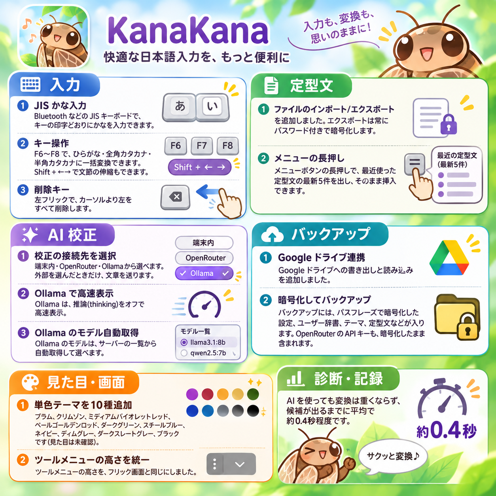

# KanaKana

Bluetooth などの **JIS キーボードで「かな入力」ができる** Android 向け日本語 IME です。
[Komorebi IME](https://github.com/zenskypj/Komorebi-IME)(ZenSky Project)のフォークで、
Komorebi の機能(フリック・QWERTY、Mozc 変換、Karukan、ユーザー辞書、きせかえなど)はそのまま使えます。



## 最新版

[GitHub Releases の最新版(v1.0.3)](https://github.com/onboard-dev/Kanakana/releases/latest) から APK を入手できます。debug 署名のテスト用で、アプリ ID は `jp.kanakana.ime.debug` です。

## 動作確認した環境

### 端末

| 端末 | SoC | メモリ | OS |
|---|---|---|---|
| Galaxy S23(ドコモ版、型番 SC-51D) | Qualcomm SM8550(Snapdragon 8 Gen 2 for Galaxy)、8 コア | 8 GB | Android 16(API 36) |
| TECLAST T70(タブレット) | MediaTek MT8781 | 8 GB | Android 14(API 34) |
| ALLDOCUBE iPlay60 mini(タブレット) | Unisoc T606 | 4 GB | Android 15(API 35) |

### Bluetooth キーボード

| キーボード | 配列 |
|---|---|
| [Omikamo キーボード bluetooth 折り畳み式 ワイヤレス JIS標準日本語配列](https://www.amazon.co.jp/dp/B0CWKWXP37) | JIS |
| [SANWA SKB-BT32BK](https://www.sanwa.co.jp/product/syohin?code=SKB-BT32BK) | JIS |

上記以外の端末・キーボードでは、動作を確認していません。端末ごとに、確認できた機能の範囲は異なります。

## 開発に使用している AI

Claude Opus 5.5(Anthropic)

## KanaKana で追加したこと

- **JIS かな入力**: キーに印字されたかなどおりに入力します(か → `T`、゛ → `@`、゜ → `[`)。
  濁点・半濁点・小書き文字(`Shift`+`7` で ゃ など)は Mozc のかな入力モードが合成します。
- **候補バーのみの表示**: ハードウェアキーボードの接続中は、画面のキーを隠して候補バーだけを表示します。
  バー右端の `⌨` で画面キーボードを出せます。キーボードを外すと自動で戻ります。
- **入力モードの表示**: メニューボタンの右に、かな入力は「あ」(初期値はミルキーグリーン)、英字入力は「A」(初期値は水色)を表示します。
  タップで切り替えられます。背景の色は、設定 → 入力方式で、8色から選べます。
- **英数入力のときも JIS 配列の記号**: 端末が JIS キーボードを英語(US)配列として扱うと、`¥` や `ろ` のキーが入らず、
  `Shift`+`2` が `@` になります。KanaKana が、キーの位置から、印字どおりの記号(`¥`、`\`、`"`、`'`、`:` など)を入力します。
  英語(US)配列のキーボードをつなぐときは、設定 → 入力方式の「JIS配列の記号(英数入力のとき)」をオフにします。
- **認識されているキーボードの表示**: 設定 → 入力方式の最上部に、つながっているキーボードの名前と配列(JIS かどうか、端末が英語配列として扱っているか)を表示します。
  JIS かどうかは、JIS 配列にしかないキー(`¥`、`ろ`、変換、無変換など)が押されたときに判定します。
  カード内の「いますぐキーボード配列を判定」ボタンで、その時点の判定結果をすぐに確認できます。
- **フリック練習モード**: フリックのキーを押したとき、下フリックの文字を、斜め左下(または右下)に、70%の大きさの ▼ で表示します。指に隠れて、下フリックの文字が見えない問題への対応です。その ▼ の方向にフリックしても、下フリックの文字が入ります。設定 → 入力方式の一番下で、「表示しない」「左下」「右下」から選びます。
- **縮小表示**: ツールバーの ◾ を押すたびに、キーボード全体(メニューボタン、ツールバー、候補バー、キー)が、通常 → 60% → 50% → 40% → 30% → 通常と縮小します。縮小して空いた部分は透明で、タップは後ろのアプリに届きます。
- **パスワード、URL、メールアドレス欄、ターミナル**では、これまでどおり英数入力になります。
- 設定: 設定 → 入力方式 → 「ハードウェアキーボード(JISかな入力)」で、オン/オフを切り替えられます。

### キー操作

| キー | 動作 |
|---|---|
| 半角/全角 | かな入力 ⇄ 英数入力 |
| かな(カタカナひらがな) | かな入力をオン |
| 無変換 / 英数 | かな入力をオフ(入力中の文字は確定) |
| スペース / 変換 | 変換、次候補 |
| Enter | 確定 |
| Backspace / Delete / ← → | 入力中の文字の編集・文節移動(`Shift`+← → で文節の伸縮) |
| ↑ ↓ | 候補の移動 |
| Esc | 変換の取り消し |
| F6 / F7 / F8 | 入力中の文字を、ひらがな / 全角カタカナ / 半角カタカナに一括変換 |
| F9 / F10 | アプリにそのまま渡します(かな入力では打鍵の英字に変換されて意味がないため) |
| Ctrl / Alt との組み合わせ | そのままアプリに渡します |

一部の Bluetooth キーボードは、半角/全角を `KEY_GRAVE`(scan 41)として送ります。
KanaKana はキーのスキャンコードで判別するので、US 配列として認識されているキーボードでも動作します。

## Komorebi IME からの変更点

KanaKana は Komorebi IME(rc.68-dev)をもとに、次の点を変更しています。これ以外は上流と同じ動作です。
仕様を変更したら、この一覧を更新します。

| 区分 | 変更内容 |
|---|---|
| 入力 | 物理 JIS キーボードのかな入力を追加(`HardwareKana.kt`、`HARDWARE_KANA` 入力スタイル、Mozc の `preedit_method=KANA`) |
| 表示 | 物理キーボード接続中は画面のキーを隠して候補バーのみ表示。右端の `⌨` で切替。接続/切断を監視して自動で切替 |
| 設定 | 設定 → 入力方式に「ハードウェアキーボード(JISかな入力)」を追加 |
| 表示 | 物理キーボード接続中、メニューボタンの右に入力モード(かな=「あ」、英字=「A」)を表示。タップで切替。背景色は8色から選択(既定: かな=ミルキーグリーン、英字=水色。`ModeIndicatorColors.kt`) |
| 入力 | 英数入力のとき、JIS 配列の記号をスキャンコードから入力(`HardwareKana.jisSymbol`)。端末が US 配列として扱うキーボードで、`¥`・`ろ` が入らない、`Shift`+`2` が `@` になる問題への対応。設定 → 入力方式の「JIS配列の記号(英数入力のとき)」で切替(既定: オン)。パスワード・URL・端末欄では、従来どおりキーを素通し |
| 設定 | 設定 → 入力方式の最上部に「認識されているハードウェアキーボード」を追加(デバイス名、JIS 検出の有無、端末の扱い。`KeyboardLayoutInfo.kt`)。「いますぐキーボード配列を判定」ボタンで判定結果を再読み込みして表示 |
| 入力 | フリック練習モードを追加(`FlickResolver.PracticeCorner`、`FlickKeyboardView.drawPracticeHint`)。下フリックの文字を、斜め左下/右下に ▼(70%)で表示し、その斜め下へのフリックを下方向として扱う(縦横どちらからも 30°〜60° の範囲)。設定 → 入力方式の一番下で、表示しない/左下/右下を選ぶ(既定: 表示しない)。あわせて、フリックの4方向の案内の背景を不透明にした |
| 表示 | 縮小表示のツール(`ScaleBox.kt`、`UiScaleLevels.kt`)を追加。✨の右隣の ◾ を押すたびに、キーボード全体を 100→60→50→40→30→100% と縮小し、空いた部分は透明にしてタップを後ろのアプリへ通す(`onComputeInsets`)。ツールバーに並べられるツールを 5 個から 6 個にした |
| 削除キー | 左フリックで、カーソルより左をすべて削除(入力欄の先頭まで)。上フリックの右側の単語/行末までの削除と、長押しの連続削除は上流のまま |
| 定型文 | 定型文画面に、ファイルのインポート/エクスポートを追加。エクスポートは常にパスワード付きで暗号化(ファイル名 `kanakanaTemplate.enc`、AES-256-GCM、鍵は PBKDF2-HMAC-SHA256 60万回。パスワードは6文字以上、忘れると復元不可)。インポートは暗号化ファイルのほか、1行1件の平文テキスト(UTF-8、本文中の改行は2文字の「バックスラッシュ+n」)も可。追記で、重複と100件超はスキップ。保存先・取り込み元は、システムのファイル選択画面で端末内と Google ドライブから選べる |
| 定型文 | メニューボタンの長押しで、最近使った定型文の最新5件を表示し、そのまま挿入できる(使用履歴は定型文と同じく暗号化して保存) |
| 変換エンジン | 変換エンジンの選択肢を「自動(おすすめ)」「Mozcのみ」の2つに整理。「自動」のときだけ、zenzai-plus(「AI変換にzenzai-plusを優先的に使用する」)と Karukan(「Karukan変換を使用する」)を、説明・ダウンロード・チェックボックスのセクションで個別に選ぶ。優先順位は zenzai-plus が上。「Mozcのみ」では zenzai-plus も止まる(従来は止まらなかった)。従来の「Karukan」エンジンの選択肢(常時 Karukan 候補を足す)は廃止 |
| バックアップ | 「バックアップと移行」に、Google ドライブへの書き出し/読み込みボタンを追加(同じパスフレーズ暗号化のバックアップを、システムのファイル選択画面の「ドライブ」に保存・取得する。Drive API や Google ログインは使わない)。バックアップの対象に、定型文の最近使った履歴・ツールの並び順・AI校正の接続先(OpenRouter の API キーを含む)を追加 |
| テーマ | 単色のテーマ10種を追加(プラム #DDA0DD、クリムゾン #DC143C、ミディアムバイオレットレッド #C71585、ペールゴールデンロッド #EEE8AA、ダークグリーン #006400、スチールブルー #4682B4、ネイビー #000080、ディムグレー #696969、ダークスレートグレー #2F4F4F、ブラック #000000)。設定 → きせかえ → テーマで選ぶ |
| AI 文章校正 | 校正の接続先を、端末内(初期値)・OpenRouter(API キーとモデル名)・Ollama(アドレスとモデル名)から選べる。AI 文章校正モデル画面では、「クラウド(OpenRouter)またはローカル(Ollama)」のカード(「設定」ボタン付き)を、端末内モデルのカードと同じラジオボタンの組にした。外部を選んだときだけ文章を送信する。Ollama の http は私的ネットワークのみ。プライバシー本文(公開版・アプリ内版)も更新 |
| 不具合修正 | 定型文が挿入できなかった問題を修正。差し込み項目 `{{名前}}` 等の正規表現で、閉じ括弧がエスケープされておらず、Android の正規表現エンジンが構文エラーにしていた(上流にも存在する不具合) |
| 未対応 | 音声入力(別アプリ `me.zssu.ime.voice`)との連携は、パッケージ名が異なるため動作しません |

## ビルド

```
# JDK 17 以上と Android SDK が必要です
./gradlew :app:assembleDebug
```

Mozc のネイティブライブラリ(`libmozc.so`、`mozc.data`)は Git に含まれません。
Linux/WSL2 で `scripts/build_mozc.sh` を実行するか、上流の Release の APK から取り出して
`mozc/src/main/jniLibs/<abi>/libmozc.so` と `mozc/src/main/assets/mozc.data` に置いてください。
日本語を含むパスではビルドできません(AGP と protoc の制限)。`C:\dev\Kanakana` のような英数字のパスで作業してください。

- パッケージ名は `jp.kanakana.ime`(debug は `.debug`)です。Komorebi と同じ端末に共存できます。
- アップデート確認は、このリポジトリの Release を見ます。
- ライセンスは Apache License 2.0 です。Komorebi IME と Zinna-IME の著作権表示は `NOTICE` と
  アプリ内の「ライセンス」に記載しています。

このリポジトリは個人開発のため、Issues と Pull Request は受け付けていません。
自由にフォークして、自分に合ったものを作ってください。
